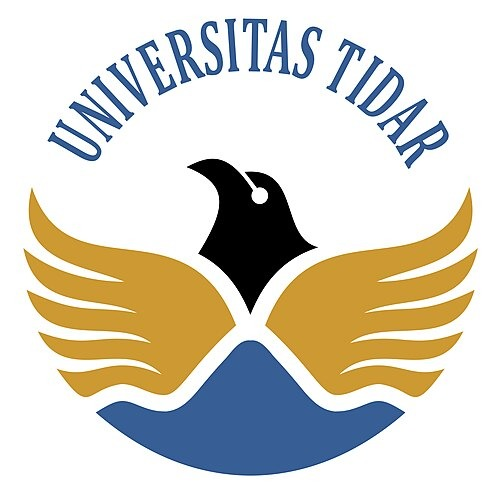

# Untidar Fixit — Solusi Digital Pengaduan & Transparansi Perbaikan Fasilitas Kampus Tuguran Universitas Tidar

<div align="center">
  
  <h2>Untidar Fixit</h2>
  <p><strong>Platform Pengaduan Cepat via QR Code & Transparansi Perbaikan Fasilitas Kampus Tuguran</strong></p>
  <p>
    <span style="color:#1e3a8a; font-weight:bold;">Primary Color: #1E3A8A</span> • 
    <span style="color:#b45309; font-weight:bold;">Accent Color: #F5E8C7</span>
  </p>
</div>

---

## 🎯 1. Problem Statement & Solusi

### Masalah Nyata Mahasiswa di Kampus Tuguran Untidar:
1. **Laporan Berulang & Spam**: Banyak mahasiswa melaporkan kerusakan yang sama (misal AC bocor di GKB 3.02 atau stop kontak perpus mati) karena tidak tahu sudah ada yang melapor.
2. **Lokasi Kurang Spesifik**: Laporan manual di grup chat sering tidak menyertakan lantai atau nomor ruangan pasti.
3. **Black Box Progres Sarpras**: Mahasiswa tidak mengetahui apakah laporan sudah dibaca, teknisi sudah ditugaskan, atau kapan estimasi selesai.

### Solusi "Untidar Fixit":
1. **Quick Report via QR Stiker Ruangan**: Mahasiswa cukup scan stiker QR di pintu kelas. Lokasi (Gedung -> Lantai -> Ruangan) terisi otomatis dengan validasi tanda tangan digital **HMAC SHA-256** anti-pemalsuan.
2. **"Saya Mengalami Hal Serupa" (Anti-Spam Upvote)**: Sistem mendeteksi otomatis jika sudah ada laporan terbuka di ruangan tersebut. Mahasiswa cukup klik 1 tombol dukungan untuk menaikkan skor prioritas tanpa membuat duplikat laporan baru.
3. **Live Progress Tracking (Timeline Transparan)**: Pelacakan progres vertikal dari status *Terkirim* ➔ *Diverifikasi* ➔ *Teknisi Ditugaskan* ➔ *Selesai (Wajib Foto Bukti Perbaikan)* atau *Ditolak (Wajib Alasan)*.
4. **Indeks Kepuasan Mahasiswa**: Sistem rating 1-5 bintang dan ulasan setelah fasilitas selesai diperbaiki.
5. **Dashboard Sarpras & Heatmap Gedung**: Tim Sarpras dapat memantau antrian berbasis skor prioritas dan peta sebaran kerusakan per gedung Tuguran.

---

## 👥 2. Kredensial Akun Mahasiswa & Admin (Demo Siap Pakai)

Semua akun demo telah dilengkapi fleksibilitas verifikasi password hackathon: **`UntidarFixit2026!`** (atau `mahasiswa123` / `admin123`).  

| No | Nama Mahasiswa / Admin | Email / Identifier | Password | Role |
|---|---|---|---|---|
| 1 | **Sarpras Untidar (Admin)** | `admin@untidar.ac.id` | `UntidarFixit2026!` | Admin Sarpras |
| 2 | **Muhammad Asyrof** | `muhammad.asyrof@students.untidar.ac.id` | `UntidarFixit2026!` | Mahasiswa |
| 3 | **Gayuh Senoaji** | `gayuh.senoaji@students.untidar.ac.id` | `UntidarFixit2026!` | Mahasiswa |
| 4 | **Widyadana Hussin F.** | `widyadanahussinfirmansyah@students.untidar.ac.id` | `UntidarFixit2026!` | Mahasiswa |
| 5 | **Satrio Purwoko** | `satriopu150105@students.untidar.ac.id` | `UntidarFixit2026!` | Mahasiswa |
| 6 | **Filbert Wibowo** | `filbert.wibowo@students.untidar.ac.id` | `UntidarFixit2026!` | Mahasiswa |

*(Tersedia tombol 1-klik `👤 Mahasiswa` dan `🛡️ Admin Sarpras` di halaman login aplikasi untuk mengisi formulir secara otomatis).*

---

## 🗄️ 3. Full Database SQL (`untidar_fixit_full_dump.sql`)

Seluruh skema database (9 tabel relasional) dan data seed resmi (98 ruangan perkuliahan data.untidar.ac.id + 23 spot denah isometrik 3D) tersedia lengkap di root repositori:
* File SQL Dump: [`untidar_fixit_full_dump.sql`](untidar_fixit_full_dump.sql)
* Skema terpisah: [`backend/database/schema.sql`](backend/database/schema.sql)
* Data Awal terpisah: [`backend/database/seed.sql`](backend/database/seed.sql)

> [!NOTE]
> File SQL ini telah dibersihkan secara penuh dari perintah `CREATE DATABASE` dan `USE laportidar;` sehingga dapat diimpor langsung ke phpMyAdmin aaPanel tanpa error `#1044 - Access denied`.

---

## 🏢 4. Data Lokasi Resmi Untidar & Ruangan Khusus FT 3 Lantai 4

Data lokasi telah diperbarui secara penuh menyinkronkan portal aset resmi [data.untidar.ac.id/Aset/FrontDaftarRuangKuliah](https://data.untidar.ac.id/Aset/FrontDaftarRuangKuliah?page=1) (total 98 lokasi resmi):
- **Gedung Fakultas Teknik 3 (FT-03) Lantai 4**:
  - `Ruang 3.4.4` (Kode: `UNT-FT3-344`)
  - `Ruang 3.4.5` (Kode: `UNT-FT3-345`)
  - `Ruang 3.4.6` (Kode: `UNT-FT3-346`)
  - `Ruang 1.4.6` (Kode: `UNT-FT3-146`)
- **Fakultas Ekonomi**: 26 Ruangan Kuliah (A.2b.01 s.d. A.4b.02, Lab Komputer)
- **Fakultas Teknik (FT-01 & FT-02)**: 29 Ruangan Kuliah & Laboratorium
- **FKIP, FISIP, & Pertanian**: Seluruh ruang perkuliahan Tuguran
- **Fasilitas Umum Tuguran**: Gedung Kuliah Bersama (GKB Lantai 1-4), Perpustakaan Pusat, Masjid Manarul Ilmi, Parkir Motor Belakang, Kantin.

Semua lokasi dilengkapi dengan kode unik dan tanda tangan digital **HMAC SHA-256** untuk fitur Quick Scan QR stiker anti-pemalsuan.

---

## 🎨 4. Skema Warna & Desain Visual (Gaya IT-Tools Modern)

Aplikasi mengadopsi antarmuka modern terinspirasi oleh **CorentinTh/it-tools** dengan tetap mempertahankan identitas resmi almamater Universitas Tidar:
* **Palet Warna Resmi**: Deep Blue Untidar (`#1E3A8A`), Royal Header Blue (`#3B5BDB`), Accent Gold Untidar (`#D97706` / `#F5E8C7`), Background Clean Soft-Slate (`#F8FAFC`).
* **Tipografi Formal**: **Plus Jakarta Sans** (Standar tipografi formal modern institusi akademik nasional, menggantikan font coding Fira).
* **Latar Belakang Login**: Foto gedung baru Universitas Tidar ditampilkan secara samar-samar (*subtle frosted blur overlay*) di belakang kartu login.
* **Layout Kartu (IT-Tools Grid)**:
  - Kotak ikon kategori dengan latar pastel lembut (AC, Kelistrikan, Sanitasi, WiFi, Furnitur, Audio).
  - Search Bar terpusat dengan shortcut `Ctrl+K`.
  - Filter chips horizontal 1-klik (termasuk filter cepat khusus *Gedung FT 3 Lt 4*).
  - Tombol upvote *Saya Mengalami Hal Serupa* interaktif.

---

## 🌐 4. Status Server Lokal yang Sedang Aktif

Aplikasi saat ini telah aktif berjalan di lokal mesin Anda:
* **Frontend Web Application**: [http://127.0.0.1:5000](http://127.0.0.1:5000)
* **Backend REST API**: [http://127.0.0.1:8000/api](http://127.0.0.1:8000/api)
* **Health Check API**: [http://127.0.0.1:8000/api/health](http://127.0.0.1:8000/api/health)

---

## ⚙️ 5. Cara Menjalankan Ulang Secara Manual

### 1. Jalankan Backend (Port 8000)
```bash
cd backend
php -S 127.0.0.1:8000 -t public
```

### 2. Jalankan Frontend Web (Port 5000)
```bash
cd frontend
# Opsi A: Serve hasil build release static
php -S 127.0.0.1:5000 -t build/web

# Opsi B: Jalankan via flutter run
flutter run -d chrome --web-port 5000
```

---

## 🧪 6. Uji Otomatis & Keamanan (Test Suite)

```bash
# Uji 21 Unit API Test
php backend/test_api.php

# Uji Simulasi 11 Langkah End-to-End Flow
php backend/test_e2e_flow.php
```
Semua pengujian telah terverifikasi **100% Passed**.
